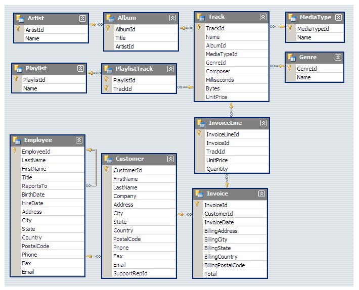

# SQL Project: Music Store Analysis

Read the full detailed article <a href="https://avishek-choudhary.github.io/projects/Music%20Store.html">here</a>.

## Description

This project uses SQL to analyze the dataset of an online music store. The goal of the project is to answer a set of questions about the store's business performance and help in its growth by making better decisions.

## Installation

To run this project on your machine you need to install any SQL-supported DBMS then follow the steps below:
1. Create a database.
2. Create tables using the schema diagram provided below.
3. Import csv files provided in the <a href="https://github.com/avishek09/Music-Store-Analysis/tree/main/dataset">dataset</a> folder.

Note: If you are using PostgreSQL then restore the <a href="https://github.com/avishek09/Music-Store-Analysis/blob/main/music_store_db_backup">backup</a> file of the database and save yourself some time.

## Schema Diagram


<!-- ## Usage

Provide instructions and examples for use. Include screenshots as needed.

To add a screenshot, create an `assets/images` folder in your repository and upload your screenshot to it. Then, using the relative filepath, add it to your README using the following syntax:

    ```md
    
    ``` -->

## Database and Tools

* Postgre SQL
* PgAdmin4
